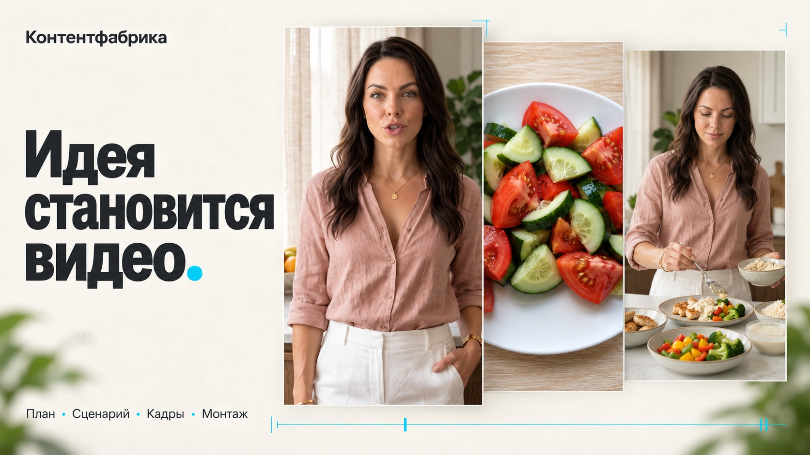
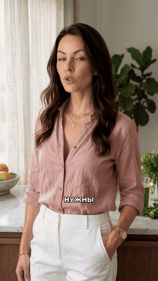
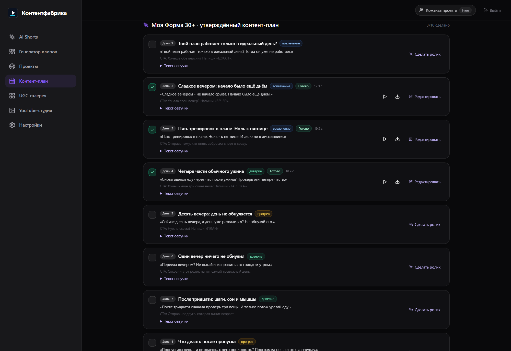
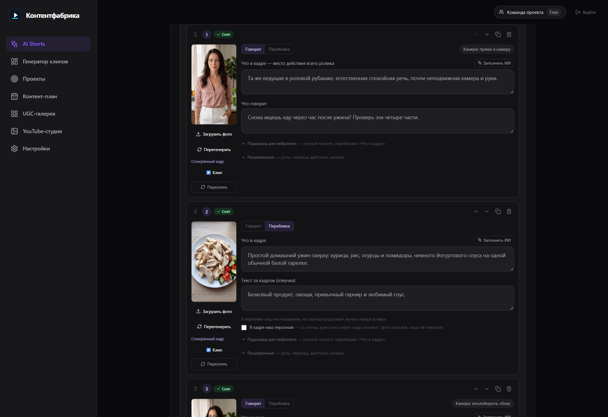
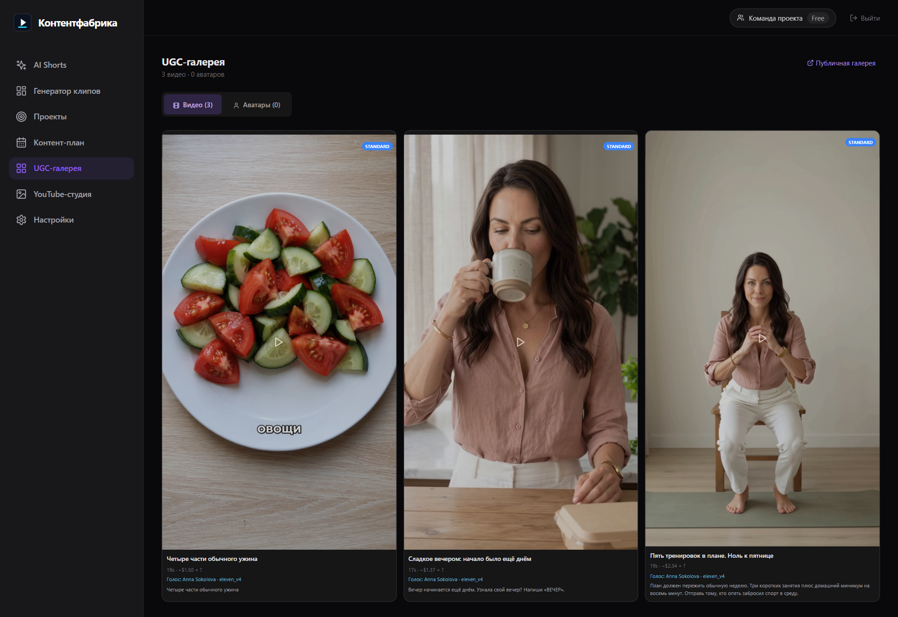
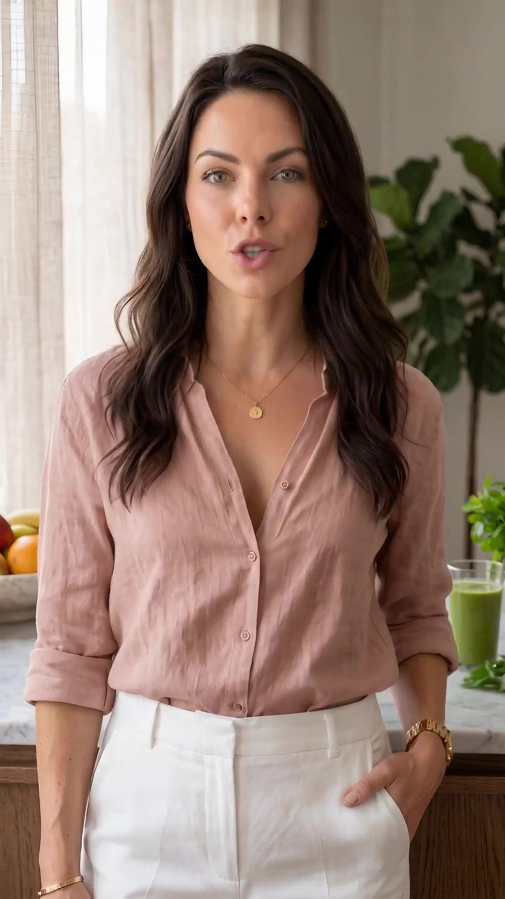
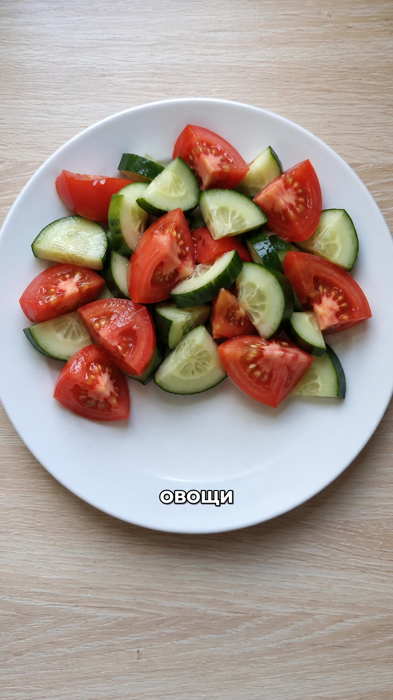
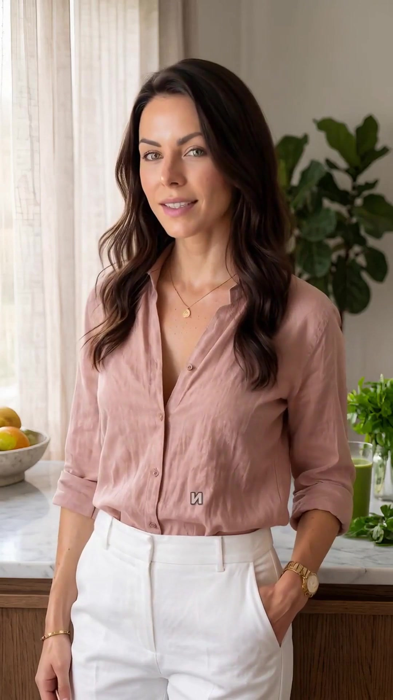
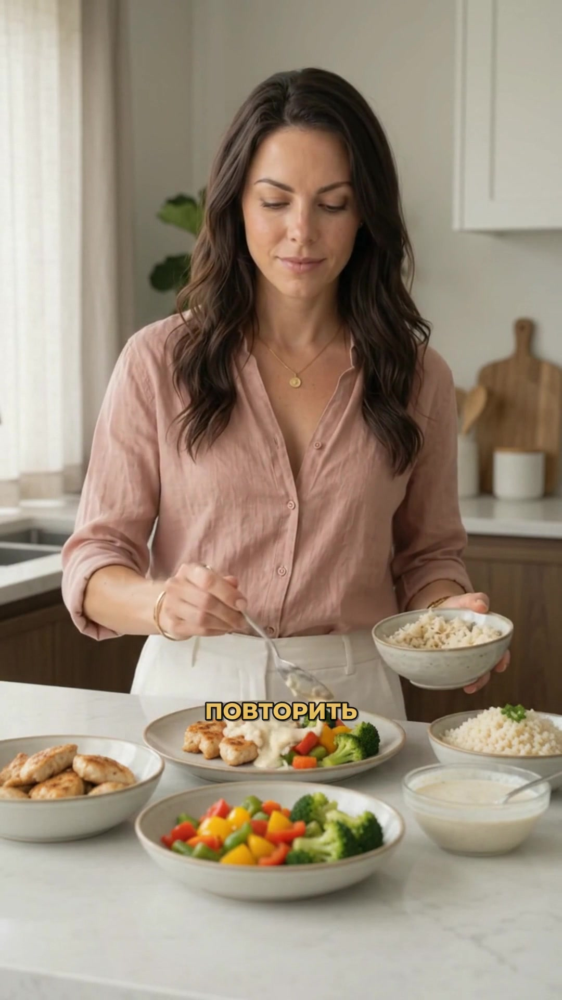

# Контентфабрика

### От идеи — к ролику, который хочется показать.

Контент-план, сценарий, AI-ведущий, голос и монтаж. Контентфабрика собирает этапы производства коротких видео в один понятный процесс — для бизнеса, экспертов и команд.

**[Смотреть витрину и готовый ролик ↗](https://a-m-u-r.github.io/content-fabric/)**

## Сначала — результат

**«Четыре части обычного ужина» — ролик 04 из нашего контент-плана.** Готовое вертикальное видео: 18,9 секунды, русская озвучка, смена кадров и субтитры. В ролике — синтетическая AI-ведущая.

[Смотреть видео со звуком](https://a-m-u-r.github.io/content-fabric/#result) · [Открыть MP4](assets/video-04-dinner.mp4)

## Весь путь — перед глазами

### Темы на месяц

Сохраните описание бизнеса и соберите контент-план из 8, 12, 16 или 30 роликов. У каждого пункта — тема, первая реплика и цель. Разные проекты хранят свои продукты, идеи и материалы.

### Каждая сцена под контролем

Начните с описания, ссылки на продукт или собственного текста. Отредактируйте реплики, прослушайте голос и проверьте кадры до видеогенерации. Порядок сцен и выборочную пересъёмку можно менять по ходу работы.

### Готовые версии рядом

Смотрите результат в галерее, возвращайтесь к раскадровке и сохраняйте новые версии. Меняйте музыку, проверяйте расходы по этапам и скачивайте готовое видео.

*Настоящий интерфейс на демонстрационном аккаунте. Любой экран можно открыть в полном размере.*

## Одна история. Разные планы.

Обращение в камеру, детали блюда и действие — кадры из того же ролика.

| Ведущая в кадре | Детали блюда | Смена крупности | Действие в кадре |
|---|---|---|---|
|  |  |  |  |

**План. Голос. Кадры. Готовый ролик.**

[Посмотреть Контентфабрику в действии ↗](https://a-m-u-r.github.io/content-fabric/)
